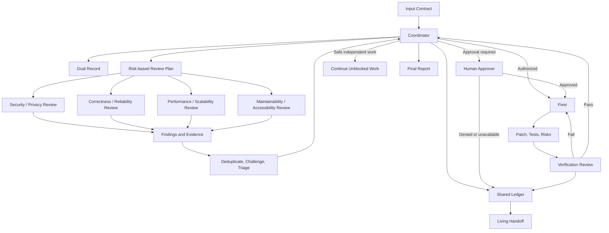
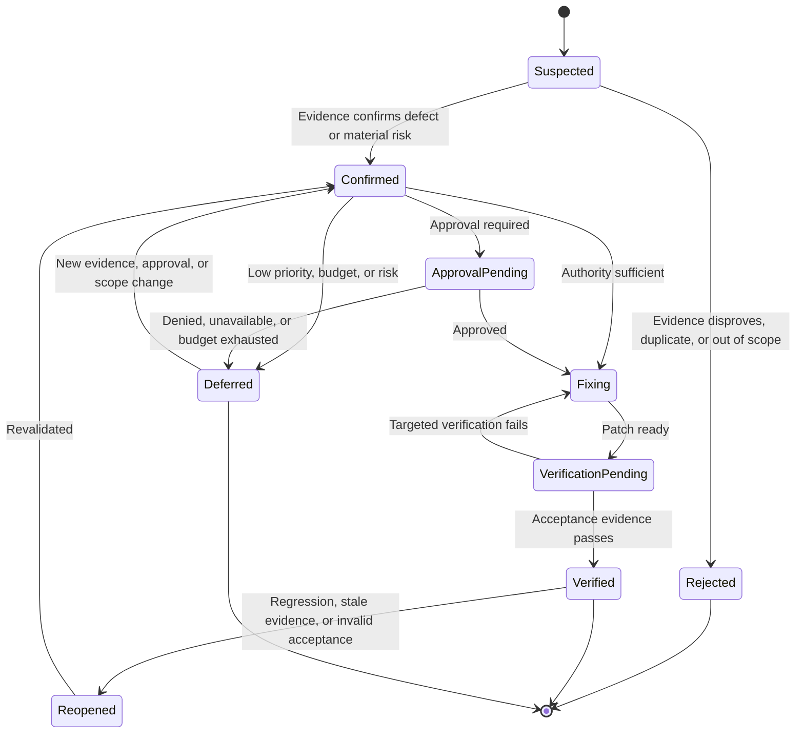
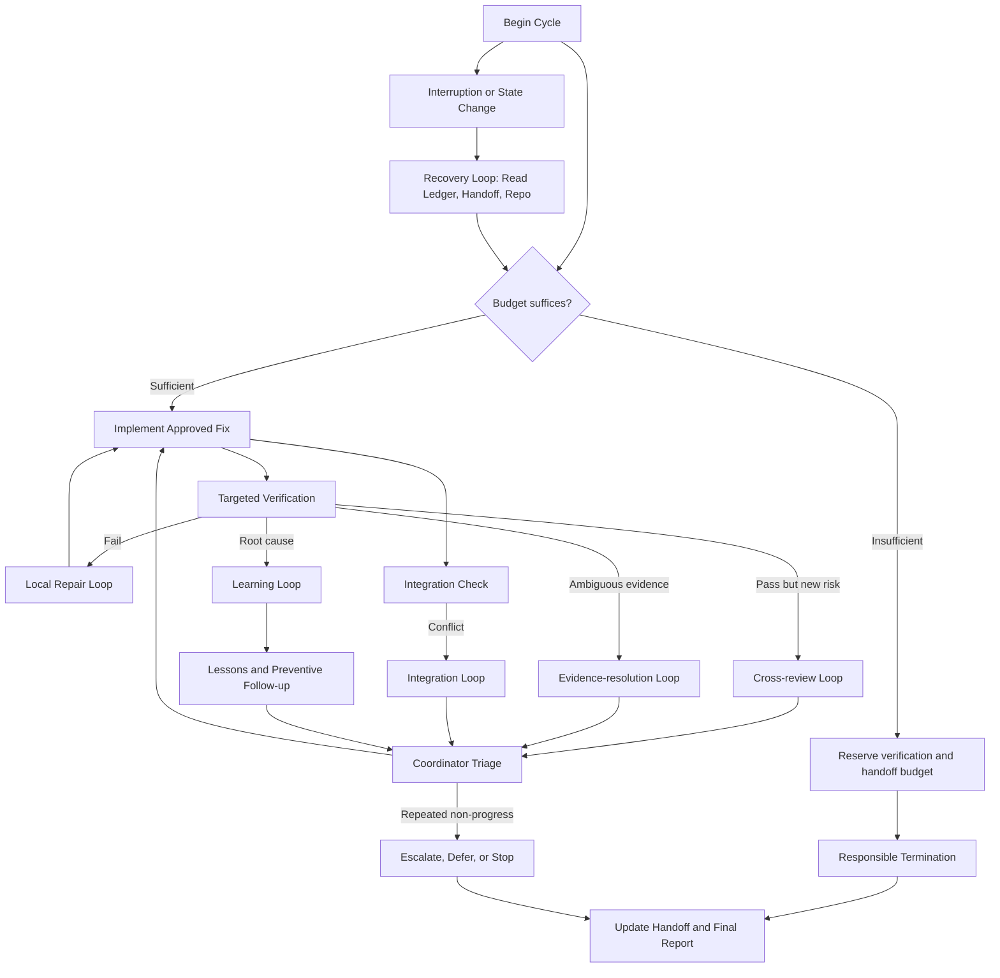

# Orchestrated improvement — verify

Load only when this phase starts.

## 9. Verification standards

Verification must include:

- Baseline versus post-change comparison.
- Reproduction of the original defect where feasible.
- Regression tests that fail before and pass after a fix when practical.
- Targeted tests first.
- Relevant broader checks based on risk.
- Integration or end-to-end checks at important boundaries.
- Performance measurements before making improvement claims.
- Explicit treatment of flaky tests, unavailable dependencies, and environmental failures.
- Verification of the integrated patch state, not just isolated changes.

Record:

- Actual commands.
- Execution context.
- Results.
- Exit codes when available.
- Limitations.
- Evidence tied to finding IDs.

Rules:

- A passing suite is evidence, not proof of universal correctness.
- Do not mark a finding verified merely because code changed.
- Do not mark a finding verified unless its acceptance criteria are met by actual evidence.
- If a check could not be run, list it as a proposed but unexecuted check.
- If a test is flaky, record flakiness, retry evidence if available, and residual uncertainty.
- If a dependency is unavailable, mark verification blocked and record the missing dependency.

## 13. Diagrams

### 13.1 Orchestration and information flow

### 13.2 Finding lifecycle

This diagram describes the lifecycle of a single finding. Deferral or rejection ends only that finding, not the entire run.

### 13.3 Bounded feedback and recovery loops

## 14. Stop conditions and final output contract

### 14.1 Successful completion

A run is successfully completed when:

- Selected work meets its acceptance criteria.
- No blocking findings remain for the selected work.
- Verification evidence is recorded.
- Ledger and handoff are consistent.
- Final report is produced.

### 14.2 Responsible termination

A run may terminate responsibly when:

- Iteration or execution budget is exhausted.
- Further progress requires unavailable information, capability, or approval.
- Remaining findings are explicitly deferred with rationale.
- Continuing would create unacceptable risk.
- Recovery cannot safely restore a coherent working state.

Successful completion and responsible termination are distinct outcomes.

### 14.3 Stop rules

Stop when any of the following is true:

- Selected work is complete and verified.
- Budget is exhausted.
- Required approval is unavailable.
- Required capability is unavailable.
- Remaining work is deferred with rationale.
- Continuing would violate safety or authority boundaries.

At termination, prominently report unresolved critical or high-priority risks.

### 14.4 Final report requirements

Produce a concise final report containing:

1. Scope and assumptions.
2. Outcome:
   - completed,
   - partially completed,
   - review-only,
   - blocked,
   - budget-exhausted,
   - terminated for safety, or
   - responsibly deferred.
3. Findings by family, priority, and status.
4. Fixes linked to finding IDs.
5. Actual verification commands and results.
6. Proposed but unexecuted checks.
7. Unresolved and deferred findings with rationale.
8. Lessons and preventive improvements.
9. Recommended next action.
10. The six-section handoff, or an authorized artifact location with a concise summary.

Avoid duplicating the same material unnecessarily across the ledger, final report, and handoff. Use the ledger for detailed evidence, the handoff for operational continuity, and the final report for summary and closure.

## 15. Pre-termination validation checklist

Before terminating, verify that:

- Authority rules were respected.
- Every fix has a linked finding or named task.
- Every verified finding has current, non-stale evidence.
- No worker independence was claimed where none existed.
- Iteration and budget accounting are explicit.
- Failed attempts are actual attempts, not rejected proposals.
- Deferred findings do not falsely terminate unrelated work.
- Recovery and budget-exhaustion paths are documented.
- The handoff contains exactly six top-level sections.
- No invented file paths, line numbers, commands, measurements, or results are present.
- Unresolved critical or high risks are prominently reported.
